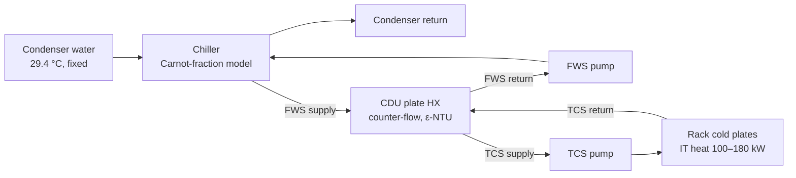
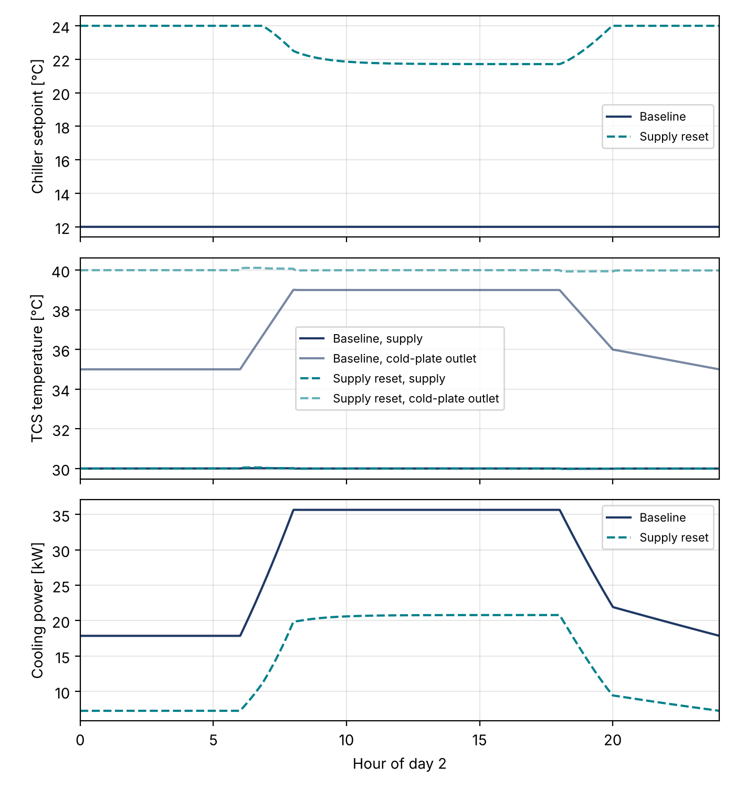

# Chiller–CDU Loop for a Liquid-Cooled Data-Center Pod (Modelica)

A system-level Modelica model of a liquid-cooled rack pod: a water-cooled chiller, the
facility water system (FWS), a coolant distribution unit (CDU) and the rack cold-plate
loop (technology cooling system, TCS). Two control sequences are compared on chiller and
pump energy while the cold plates receive the same 30 °C supply water.

Built with the [Modelica Buildings Library](https://simulationresearch.lbl.gov/modelica/)
14.0.0 and simulated in OpenModelica 1.27.



## Plant

| Item | Design value |
|---|---|
| Rack heat captured by liquid | 200 kW at full IT load |
| IT load profile | 50% night, 90% day, linear ramps (periodic, 24 h) |
| TCS supply setpoint (cold-plate inlet) | 30 °C |
| TCS temperature rise at design | 10 K (4.78 kg/s) |
| FWS temperature rise at design | 8 K (5.98 kg/s) |
| CDU sizing point | 200 kW, 40 °C TCS return, 22 °C FWS supply |
| Chiller | 240 kW evaporator capacity, 45% of Carnot COP |
| Condenser water | 29.4 °C entering, constant flow |
| Pressure drops | cold plates 50 kPa, CDU 30 kPa each side, chiller 30 kPa each side |

## Control sequences

| | Baseline | SupplyReset |
|---|---|---|
| Chiller leaving-water setpoint | Fixed 12 °C | Reset 12–24 °C by a slow PI loop that keeps the FWS pump near 85% speed |
| FWS pump | PI holds TCS supply at 30 °C | Same |
| TCS (CDU secondary) pump | Constant design speed | PI holds a 10 K rise across the cold plates (min. 30% speed) |

The reset loop raises the chiller setpoint while the FWS pump has spare capacity. At peak
load the pump needs more flow, so the setpoint settles lower (about 21.7 °C here).

## Results (day 2 of a 2-day run)

| Case | IT heat [kWh] | Chiller [kWh] | FWS pump [kWh] | TCS pump [kWh] | Cooling total [kWh] | Cooling / IT | Mean chiller COP | Max cold-plate outlet [°C] |
|---|---|---|---|---|---|---|---|---|
| Baseline | 3420 | 627.2 | 5.0 | 20.9 | 653.2 | 0.19 | 5.5 | 39.0 |
| SupplyReset | 3420 | 317.5 | 10.3 | 10.8 | 338.6 | 0.10 | 10.8 | 40.1 |



**Read these numbers with care.** Almost all of the saving comes from the chiller, and
the chiller model is a fixed fraction of the Carnot COP. That model has no minimum-lift
limit and no part-load penalty, so it overstates COP at warm leaving-water temperatures
(COP near 15 at 24 °C). The difference is therefore an upper bound on what a reset could
save, not an estimate for a real plant. Replacing the chiller with a manufacturer-curve
model is the first planned extension.

## Assumptions and limitations

- All rack heat goes to the liquid loop; no air-side load.
- No cooling tower or dry cooler: condenser water temperature is fixed.
- No waterside economizer. With 30 °C TCS supply, much of this load could be met without
  the chiller; that comparison is not modeled yet.
- No pipes, valves, bypass lines, pump staging or chiller cycling.
- Ideal sensors; PI gains were tuned by hand for stable response, not optimized.
- The first day of each run is discarded as warm-up.

## How to run

**OMEdit (OpenModelica):** install *Modelica 4.1.0* and *Buildings 14.0.0* through
*File > Manage Libraries > Install Library*. Open `ChillerCDULoop/package.mo`, then simulate
`ChillerCDULoop.Examples.Baseline` and `ChillerCDULoop.Examples.SupplyReset` with stop time
172800 s and 2880 output intervals.

**Command line plus figures:**

```bash
pip install numpy scipy matplotlib
python scripts/run.py            # runs omc, writes results/summary.md and figures/
python scripts/run.py --skip-sim # post-process existing results only
```

If the libraries are not in OpenModelica's default library folder, pass their locations,
for example `--modelica-path "C:/libs/msl;C:/libs/modelica-buildings"`.

## Repository layout

```
ChillerCDULoop/
  BaseClasses/PartialPlant.mo   plant hydraulics, chiller, CDU, cold plates, FWS control, meters
  Examples/Baseline.mo          fixed setpoint, constant-speed TCS pump
  Examples/SupplyReset.mo       variable TCS pump and chiller setpoint reset
scripts/
  simulate.mos                  OpenModelica script for both cases
  run.py                        simulate, summarize, plot
  omres.py                      reader for OpenModelica .mat results
figures/                        plots from run.py
results/summary.md              day-2 energy table from run.py
```

## Planned extensions

1. Manufacturer-curve chiller (`Buildings.Fluid.Chillers.ElectricEIR`) with a minimum-lift limit.
2. Cooling tower and waterside economizer, run against a year of weather data.
3. Cold-plate thermal resistance so chip-case temperature, not only coolant temperature,
   sets the limit on supply-temperature reset.
4. Pump and valve hydraulics for several racks in parallel.
